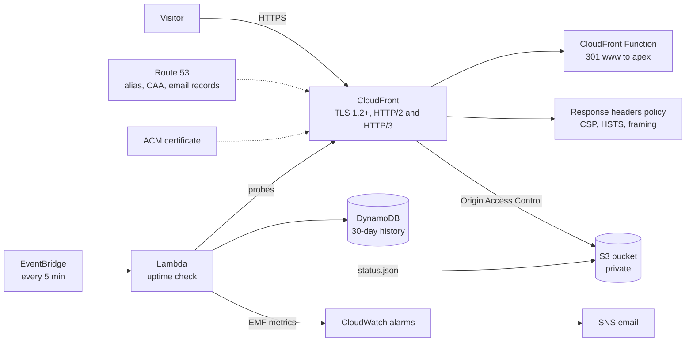

# robgantz.dev

Source and infrastructure for [robgantz.dev](https://robgantz.dev), my resume and case-study site.

The site is static HTML, CSS and JavaScript, served from a private S3 bucket through CloudFront. Every AWS resource behind it is defined in Terraform, and a Lambda health check publishes a [live status page](https://robgantz.dev/status.html).

## Architecture



| Piece | What it does |
|---|---|
| S3 | Holds the files. Public access is blocked; only CloudFront can read it, through Origin Access Control. |
| CloudFront | Serves the site over TLS 1.2+ with HTTP/2 and HTTP/3. Missing pages return a custom 404. |
| CloudFront Function | Redirects `www` and the default `cloudfront.net` hostname to the apex with a 301, keeping the query string. |
| ACM | Certificate for the apex and `www`, validated through DNS and renewed automatically. |
| Route 53 | DNS, CAA records that let only Amazon issue certificates, and SPF/DKIM/DMARC for email. |
| Lambda + EventBridge | Checks every page every 5 minutes: status code, latency, security headers, and certificate expiry. |
| DynamoDB | One item per day of check results, expiring after 40 days, used for uptime and the error budget. |
| CloudWatch + SNS | Alarms email me if the site is down, the checker stops reporting, security headers go missing, or the certificate is within 21 days of expiry. |
| AWS Budgets | Emails me if monthly spend heads past $5. |

## Monitoring and SLO

The [status page](https://robgantz.dev/status.html) is fed by the uptime Lambda ([`uptime_check.py`](infra/terraform/lambda/uptime_check.py)):

- **SLO:** 99.9% availability over a rolling 30 days, which allows 43.2 minutes of downtime.
- **Availability:** a check passes only if every page returns 200.
- **Error budget:** each failed check spends 5 minutes of the 43.2.
- **Metrics:** published through CloudWatch Embedded Metric Format, so the checker needs no `PutMetricData` permission.
- **Alarms** include a "checker stale" alarm that fires on missing data, so a broken checker can't look like a healthy site.

The SLO math is unit tested ([`test_uptime_check.py`](infra/terraform/lambda/test_uptime_check.py)) and runs in CI.

## Security

Everything here is checkable from outside with `curl -I https://robgantz.dev`.

- **Private origin.** Direct S3 URLs return 403. The bucket only answers CloudFront.
- **Response headers:** a strict Content-Security-Policy (scripts only from this site and the analytics host, no inline scripts), two-year HSTS with preload, `X-Frame-Options: DENY`, `nosniff`, referrer policy, Permissions-Policy and COOP. `Server` and the S3 encryption header are stripped.
- **One hostname.** www and the CloudFront domain redirect to the apex.
- **Certificate issuance locked down.** CAA allows Amazon only, with no wildcard certificates.
- **Email spoofing protection.** SPF and DKIM aligned, DMARC set to quarantine.
- **No stored cloud keys.** GitHub Actions authenticates to AWS through OIDC with short-lived tokens. Every role trusts only this repo and is scoped to what its job needs.
- **Analytics without tracking.** [GoatCounter](https://www.goatcounter.com): no cookies, no personal data.

## CI/CD

Two GitHub Actions workflows, both using OIDC roles:

| Workflow | Trigger | What it does | AWS role |
|---|---|---|---|
| [`deploy.yml`](.github/workflows/deploy.yml) | Push to `main` touching `site/` | Uploads files, invalidates the cache, smoke-tests pages and headers | Upload to the site bucket and invalidate the distribution, nothing else |
| [`terraform.yml`](.github/workflows/terraform.yml) | Pull request | `fmt` check, Lambda unit tests, `terraform plan` | Read-only |
| | Push to `main` touching `infra/terraform/` | Plan and apply, after approval in the `production` environment | Write access limited to this project's resources by name and ARN |

## Repo layout

```
site/              What gets deployed: HTML, CSS, JS, fonts, images, status page
infra/terraform/   All AWS infrastructure: site, DNS, monitoring, CI roles
  lambda/          Uptime checker and its unit tests
  functions/       CloudFront Function source
scripts/           deploy.sh: upload site/ with explicit content types and cache headers
licenses/          Third-party licenses (Geist fonts, SIL OFL 1.1)
```

## Running Terraform locally

```bash
cd infra/terraform
cp backend.hcl.example backend.hcl            # fill in the state bucket
cp terraform.tfvars.example terraform.tfvars  # fill in bucket names
terraform init -backend-config=backend.hcl
terraform plan
```

State lives in a private, versioned S3 bucket with native S3 locking. Account and resource IDs stay out of the repo: they're passed in through untracked files locally and GitHub secrets in CI.

The existing infrastructure was originally built by hand and imported into Terraform. The configuration was written to match production: the import changed no live settings, and a plan run right after it showed no drift.

## Credits

Fonts: [Geist and Geist Mono](https://github.com/vercel/geist-font) by Vercel, under the SIL Open Font License 1.1 ([`licenses/Geist-OFL.txt`](licenses/Geist-OFL.txt)).
