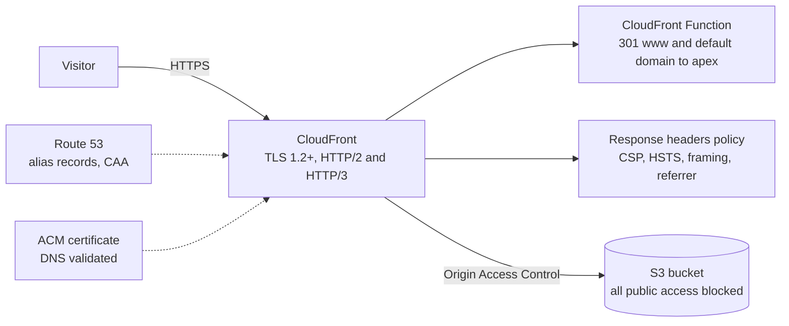

# robgantz.dev

Source and infrastructure for [robgantz.dev](https://robgantz.dev), my resume and case-study site.

The site is static HTML, CSS and JavaScript, served from a private S3 bucket through CloudFront. There's no framework, no server and no build step to deploy it.

## Architecture



| Piece | What it does |
|---|---|
| S3 | Holds the files. Public access is blocked; only CloudFront can read it, through Origin Access Control. |
| CloudFront | Serves the site over TLS 1.2+ with HTTP/2 and HTTP/3. Missing pages return a custom 404. |
| CloudFront Function | Redirects `www` and the default `cloudfront.net` hostname to the apex with a 301, keeping the query string. |
| ACM | Certificate for the apex and `www`, validated through DNS. |
| Route 53 | DNS, plus CAA records that let only Amazon issue certificates for the domain. |

## Security

Everything here is checkable from outside with `curl -I https://robgantz.dev`.

- **Private origin.** Direct S3 URLs return 403. The bucket only answers CloudFront.
- **Response headers** ([`infra/cloudfront/security-headers.json`](infra/cloudfront/security-headers.json)):
  - Content-Security-Policy: scripts only from this site and the analytics host, no inline scripts, no framing.
  - HSTS for two years, with `includeSubDomains` and `preload`.
  - `X-Frame-Options: DENY`, `nosniff`, `strict-origin-when-cross-origin` referrer policy, Permissions-Policy, COOP.
  - `Server` and the S3 encryption header are stripped.
- **One hostname.** www and the CloudFront domain redirect to the apex ([`canonical-host.js`](infra/cloudfront/canonical-host.js)).
- **Certificate issuance locked down.** CAA allows Amazon only, with no wildcard certificates ([`caa.json`](infra/route53/caa.json)).
- **Disclosure contact** at [`/.well-known/security.txt`](https://robgantz.dev/.well-known/security.txt).
- **Analytics without tracking.** [GoatCounter](https://www.goatcounter.com): no cookies, no personal data.

## Repo layout

```
site/      What gets deployed: HTML, CSS, JS, fonts, images
infra/     CloudFront headers policy and function, Route 53 CAA and DMARC records, IAM deploy role
.github/   Deploy workflow (GitHub Actions, OIDC to AWS)
scripts/   deploy.sh: upload site/ with explicit content types and cache headers, then invalidate
licenses/  Third-party licenses (Geist fonts, SIL OFL 1.1)
```

## Deploy

Pushing to `main` deploys automatically ([`.github/workflows/deploy.yml`](.github/workflows/deploy.yml)):

1. GitHub Actions requests a short-lived OIDC token. No AWS keys are stored in GitHub.
2. AWS trades the token for temporary credentials on an IAM role that trusts only the `main` branch of this repo. The role can upload to the site bucket and invalidate the distribution, nothing else.
3. `scripts/deploy.sh` uploads `site/` and invalidates the cache.
4. A smoke test checks that each page returns 200 and that the security headers are present.

To deploy by hand:

```bash
BUCKET=<bucket-name> DISTRIBUTION_ID=<distribution-id> ./scripts/deploy.sh             # whole site
BUCKET=<bucket-name> DISTRIBUTION_ID=<distribution-id> ./scripts/deploy.sh index.html  # selected files
```

Needs AWS CLI v2 and credentials that can write to the bucket and create invalidations. HTML is cached for 5 minutes, scripts and icons for an hour, and fonts and images for longer.

The resume PDF is uploaded separately and isn't kept in git.

## Next

- Define the bucket, distribution, DNS and deploy role in Terraform.

## Credits

Fonts: [Geist and Geist Mono](https://github.com/vercel/geist-font) by Vercel, under the SIL Open Font License 1.1 ([`licenses/Geist-OFL.txt`](licenses/Geist-OFL.txt)).
